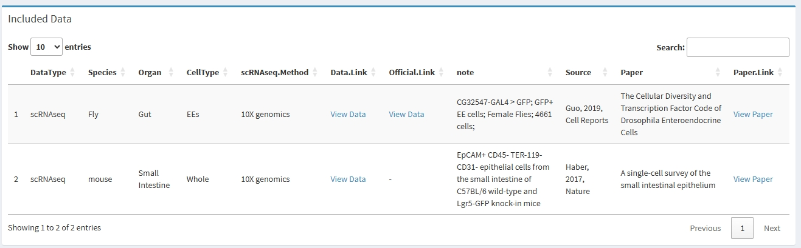
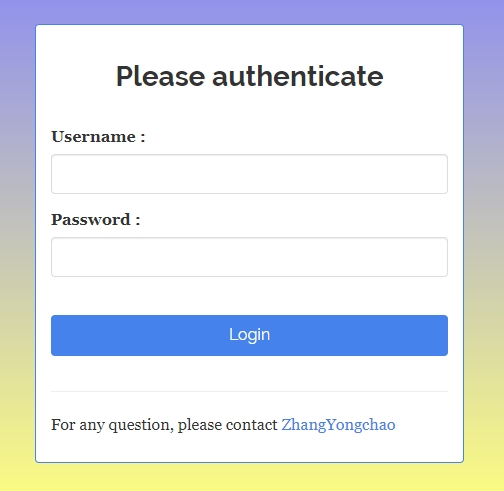
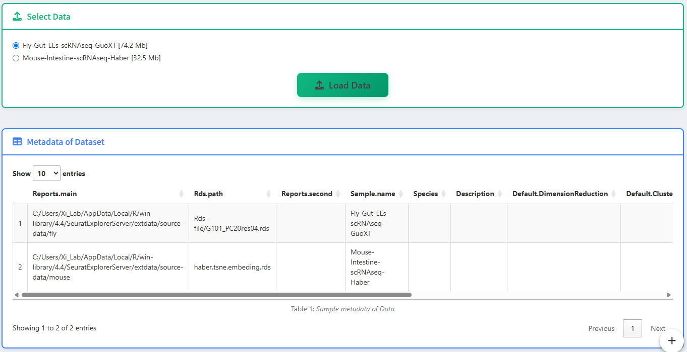
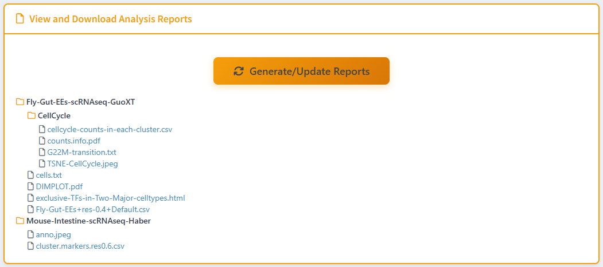
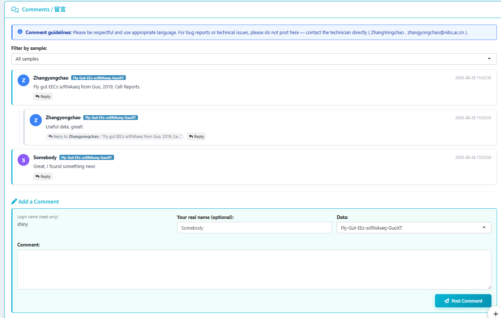
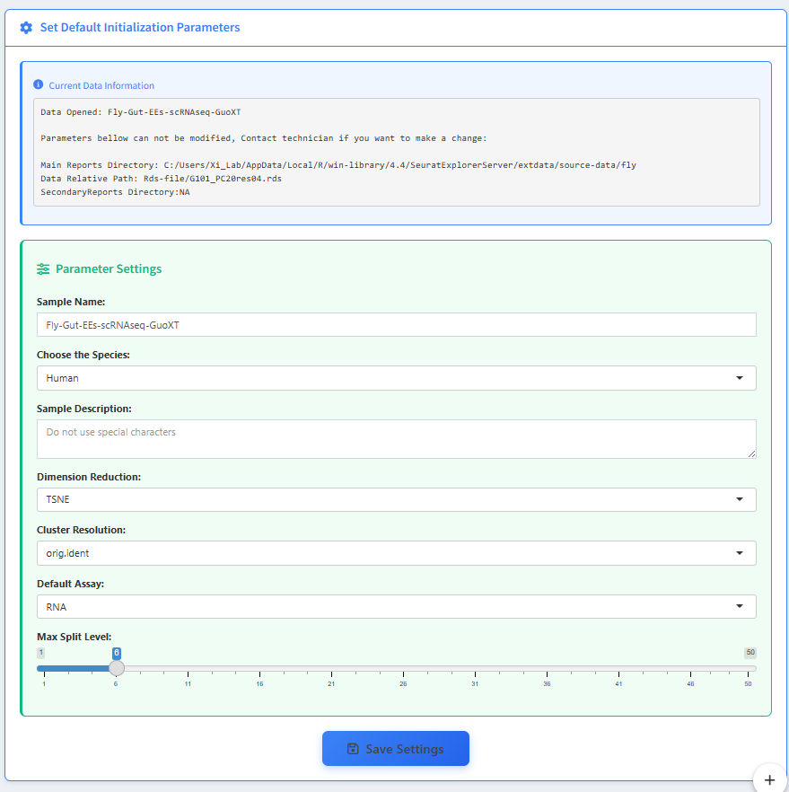

<!-- README.md is generated from README.Rmd. Please edit that file -->

# SeuratExplorer Server


<!-- badges: start -->

[](https://github.com/fentouxungui/SeuratExplorerServer)
[](https://github.com/fentouxungui/SeuratExplorerServer)
[](https://github.com/fentouxungui/SeuratExplorerServer/commits/main)
[](https://github.com/fentouxungui/SeuratExplorerServer/stargazers)
[](https://cran.r-project.org/web/licenses/GPL_3)
[](https://deepwiki.com/fentouxungui/SeuratExplorerServer)
[![AskZreadAI](https://img.shields.io/badge/Ask_Zread-_.svg?style=flat&color=00b0aa&labelColor=000000&logo=data%3Aimage%2Fsvg%2Bxml%3Bbase64%2CPHN2ZyB3aWR0aD0iMTYiIGhlaWdodD0iMTYiIHZpZXdCb3g9IjAgMCAxNiAxNiIgZmlsbD0ibm9uZSIgeG1sbnM9Imh0dHA6Ly93d3cudzMub3JnLzIwMDAvc3ZnIj4KPHBhdGggZD0iTTQuOTYxNTYgMS42MDAxSDIuMjQxNTZDMS44ODgxIDEuNjAwMSAxLjYwMTU2IDEuODg2NjQgMS42MDE1NiAyLjI0MDFWNC45NjAxQzEuNjAxNTYgNS4zMTM1NiAxLjg4ODEgNS42MDAxIDIuMjQxNTYgNS42MDAxSDQuOTYxNTZDNS4zMTUwMiA1LjYwMDEgNS42MDE1NiA1LjMxMzU2IDUuNjAxNTYgNC45NjAxVjIuMjQwMUM1LjYwMTU2IDEuODg2NjQgNS4zMTUwMiAxLjYwMDEgNC45NjE1NiAxLjYwMDFaIiBmaWxsPSIjZmZmIi8%2BCjxwYXRoIGQ9Ik00Ljk2MTU2IDEwLjM5OTlIMi4yNDE1NkMxLjg4ODEgMTAuMzk5OSAxLjYwMTU2IDEwLjY4NjQgMS42MDE1NiAxMS4wMzk5VjEzLjc1OTlDMS42MDE1NiAxNC4xMTM0IDEuODg4MSAxNC4zOTk5IDIuMjQxNTYgMTQuMzk5OUg0Ljk2MTU2QzUuMzE1MDIgMTQuMzk5OSA1LjYwMTU2IDE0LjExMzQgNS42MDE1NiAxMy43NTk5VjExLjAzOTlDNS42MDE1NiAxMC42ODY0IDUuMzE1MDIgMTAuMzk5OSA0Ljk2MTU2IDEwLjM5OTlaIiBmaWxsPSIjZmZmIi8%2BCjxwYXRoIGQ9Ik0xMy43NTg0IDEuNjAwMUgxMS4wMzg0QzEwLjY4NSAxLjYwMDEgMTAuMzk4NCAxLjg4NjY0IDEwLjM5ODQgMi4yNDAxVjQuOTYwMUMxMC4zOTg0IDUuMzEzNTYgMTAuNjg1IDUuNjAwMSAxMS4wMzg0IDUuNjAwMUgxMy43NTg0QzE0LjExMTkgNS42MDAxIDE0LjM5ODQgNS4zMTM1NiAxNC4zOTg0IDQuOTYwMVYyLjI0MDFDMTQuMzk4NCAxLjg4NjY0IDE0LjExMTkgMS42MDAxIDEzLjc1ODQgMS42MDAxWiIgZmlsbD0iI2ZmZiIvPgo8cGF0aCBkPSJNNCAxMkwxMiA0TDQgMTJaIiBmaWxsPSIjZmZmIi8%2BCjxwYXRoIGQ9Ik00IDEyTDEyIDQiIHN0cm9rZT0iI2ZmZiIgc3Ryb2tlLXdpZHRoPSIxLjUiIHN0cm9rZS1saW5lY2FwPSJyb3VuZCIvPgo8L3N2Zz4K&logoColor=ffffff)](https://zread.ai/fentouxungui/SeuratExplorerServer)
<!-- badges: end -->

> **Build your own scRNA-seq database with ease**

SeuratExplorerServer enables bioinformatics engineers to deploy multiple
interactive web applications for visualizing single-cell RNA-seq data.
Each app supports encrypted access, multi-data switching, report
browsing, and customized initialization - all powered by the
comprehensive analysis capabilities of
[SeuratExplorer](https://github.com/fentouxungui/SeuratExplorer).

## Overview

SeuratExplorerServer is designed for bioinformatics core facilities and
research groups who need to:

- **Share analysis results** with wet-lab researchers through an
  intuitive web interface
- **Manage multiple datasets** in a centralized database with unified
  access
- **Provide secure access** to unpublished data through
  password-protected applications
- **Maintain analysis reports** alongside interactive visualizations
- **Scale deployment** across multiple projects with a single
  infrastructure

### SeuratExplorer vs SeuratExplorerServer

| Feature | SeuratExplorer | SeuratExplorerServer |
|----|----|----|
| **Use Case** | Local analysis on a single dataset | Server-side database for multiple datasets |
| **Data Access** | Upload files to app | Pre-configured data on server |
| **Multi-Data Support** | One dataset per session | Multiple datasets per app |
| **Deployment** | Local machine or single Shiny Server | Multiple apps managed by index page |
| **Authentication** | Not included | Optional password protection |
| **Report Management** | Not included | Built-in report browsing system |
| **Target Users** | Individual researchers | Bioinformatics core facilities |

### What You Get

A SeuratExplorerServer deployment usually consists of one **index app**
and one or more **data apps**:

| Component | What it provides |
|----|----|
| **Index app** | A searchable table of datasets, with links to each data app, associated publications, and external resources |
| **Data app** | A Shiny application that serves one or more Seurat objects, optionally protected by a login |
| **Dataset page** | Dataset metadata, the current data overview, a data selector, and session information |
| **Reports page** | A browsable file tree of analysis reports (PDF, HTML, images, tables, scripts, and more) |
| **Explorer pages** | The interactive SeuratExplorer analysis modules: dimension reduction, feature/violin/dot/heatmap plots, DEG analysis, correlation, and summaries |
| **Comments page** | A per-app message board for dataset-specific questions, replies, and technician follow-up |
| **Settings page** | Per-dataset defaults for species, reduction, cluster resolution, assay, split levels, and description |

## Key Features

### 🔐 Encrypted Access (Optional)

Protect unpublished data with password-protected authentication using
[shinymanager](https://github.com/datastorm-open/shinymanager).

``` r
# Simple credential setup
credentials <- data.frame(
  user = "shiny",
  password = "12345",
  stringsAsFactors = FALSE
)
```

### 🔄 Multi-Data Switching

Incorporate multiple Seurat objects from the same analysis pipeline into
a single app. For example, after extracting specific cell types for
further analysis, both the main dataset and subsets can be accessed
through one interface.

### 📊 Browsing Analysis Reports

Automatically organize and display analysis reports generated during the
pipeline. Supported formats include:

**Documents**: `pdf`, `html`, `md`, `Rmd`, `txt`, `csv`, `xlsx`, `xls`,
`xml`

**Images**: `tiff`, `tif`, `jpeg`, `jpg`, `png`, `bmp`, `svg`, `gif`

**Scripts**: `R`, `py`, `sh`, `ipynb`

**Videos**: `mp4`, `avi`

Report files are published into the app’s `www/reports/` directory.
Files on the same filesystem are linked with hard links (no extra disk
usage), while files on a different filesystem are copied; copies larger
than `MaxReportFileSize` (default 100 MB) are skipped to avoid filling
up disk. The links are served both by Shiny Server’s static `www`
handling and via `shiny::addResourcePath()`, so report downloads work
under local `runApp()` and Shiny Server (including versions ≥ 1.5.7 that
reject symlinks pointing outside `site_dir`).

### 💬 Comments / 留言与反馈

Each data app has a built-in message board for dataset-specific
discussion, so users do not have to leave the application to ask a
question or report a data issue:

- Commenter identity is taken from the Shiny login name (read-only),
  with an optional free-text real name.
- Comments can target a specific dataset and reply to a previous
  comment; the reply thread is shown as an indented tree.
- Users can post and reply; the technician (login name in
  `TechnicianUser`) can additionally mark comments as resolved or delete
  them.
- Comments are stored in a CSV file (see `CommentsFile`), with
  file-locked, atomic writes so concurrent users are safe.
- The board refreshes every 30 seconds, so comments from other users
  appear without reloading the whole app.
- A configurable size limit (`MaxCommentsFileSize`) disables new posts
  before the CSV can grow without bound, while existing comments remain
  readable.

See the **Comments / 留言与反馈** section below for the access path,
step-by-step usage, and operational notes.

### ⚙️ Customize Initialization Parameters

Set default parameters for each dataset:

- **Cluster Resolution**: Default clustering resolution
- **Species**: Human, Mouse, Fly, or custom
- **Dimension Reduction**: Default visualization method (UMAP, t-SNE,
  PCA, etc.)
- **Split Options**: Maximum levels for metadata splitting
- **Assay Selection**: Default assay to display

### 🚀 Powered by SeuratExplorer

All interactive visualization features from SeuratExplorer are included:

- 8 plot types (Dimensional reduction, Feature plot, Violin, Dot plot,
  Heatmap, etc.)
- DEGs analysis and marker discovery
- Feature correlation and summary statistics
- Multi-assay support (scRNA-seq, scATAC-seq, spatial, CITE-seq)
- Publication-ready vector PDF downloads, sized to match the on-screen
  figure
- Loaded-dataset status in the dashboard header (sample name, cells,
  features, assay, modification count)
- The **Export Data** page is hidden by default on the server, because
  it allows downloading the full Seurat object; enable it per app with
  `EnableObjectExport = TRUE`

## Live Demo

Experience the full functionality of SeuratExplorerServer:

**[Demo
Database](http://netinfo.nibs.ac.cn:666/SeuratExplorerServer-Index/)**

- **Demo 1**: Fly Gut EEs scRNA-seq (Guo, 2019, Cell Reports)
- **Demo 2**: Mouse Intestine scRNA-seq (Hung, 2020, PNAS)

## Installation

### Prerequisites

| Requirement | Notes |
|----|----|
| **R** | R (\>= 3.5.0) |
| **Shiny Server** | Required for a production deployment; optional for local testing. Install from [posit.co/download/shiny-server](https://posit.co/download/shiny-server/) |
| **Seurat** | Used to read and process the Seurat objects |
| **SeuratExplorer** | Provides the interactive analysis modules; install it from GitHub before installing this package |
| **Write access** | The Shiny process must be able to write the comment CSV, the `www/reports/` directory, and the metadata file when Settings are saved |

### R Package Dependencies

`SeuratExplorerServer` imports the following packages. Install any
missing CRAN dependencies first; `SeuratExplorer` itself must be
installed from GitHub before this package:

| Package | Role |
|----|----|
| `shiny`, `shinydashboard`, `shinyjs` | Web application framework and UI behavior |
| `DT` | Interactive metadata tables |
| `shinycssloaders` | Loading indicators for long-running outputs |
| `shinymanager` | Optional password protection |
| `Seurat`, `SeuratObject` | Single-cell object handling |
| `SeuratExplorer` | Plotting and analysis modules |
| `htmltools` | HTML UI components |
| `filelock` | Safe concurrent writes to the comment CSV |
| `plyr`, `stats`, `utils` | Data manipulation and helper utilities |

For `.qs2` support, install the `qs2` package in the R library used by
the app. If a format cannot be read, convert the object to `.rds` or
install `qs2` before deployment.

### Install SeuratExplorerServer

``` r
# Install devtools if not already installed
if (!require("devtools")) {
  install.packages("devtools")
}

# Install SeuratExplorer (dependency)
devtools::install_github("fentouxungui/SeuratExplorer")

# Install SeuratExplorerServer
options(timeout = max(300, getOption("timeout")))
devtools::install_github("fentouxungui/SeuratExplorerServer")
```

### Test Installation

``` r
library(SeuratExplorerServer)
launchSeuratExplorerServer()
```

This should launch a local instance with demo data. The default call
uses `Encrypted = TRUE`, so sign in with the demo credentials `shiny` /
`12345`; change them before exposing the app to other users.

## Quick Start

### Step 1: Prepare Your Data

Organize your Seurat analysis results with the following structure:

    project_directory/
    ├── analysis_results/
    │   ├── dataset1.rds              # Seurat object
    │   ├── clustering_report.pdf     # Analysis report
    │   ├── markers.csv               # Marker genes
    │   └── figures/                  # Additional plots
    │       ├── umap_plot.png
    │       └── heatmap.pdf
    └── secondary_analysis/           # Optional: cellranger outputs
        └── raw_counts/

### Step 2: Create Metadata File

``` r
library(SeuratExplorerServer)

# Define sample metadata
data_meta <- SeuratExplorerServer::initialize_metadata(
  Reports.main = c("/path/to/analysis1", "/path/to/analysis2"),
  Rds.path = c("dataset1.rds", "dataset2.rds"),
  Reports.second = c(NA, "/path/to/cellranger"),
  Sample.name = c("Dataset 1", "Dataset 2")
)

# Optional: Add custom parameters
data_meta$Species <- c("Mouse", "Human")
data_meta$Default.ClusterResolution <- c("res.0.4", "res.0.8")
data_meta$Default.DimensionReduction <- c("umap", "tsne")  # one value per dataset
data_meta$Description <- c("First dataset", "Second dataset")

# Verify metadata
check_metadata(parameters = data_meta)

# Save metadata
saveRDS(data_meta, file = "data_meta.rds")
```

### Step 3: Create Application

Create `app.R` in your Shiny Server directory:

``` r
#!/usr/bin/env Rscript
library(SeuratExplorerServer)

# Optional: Set up credentials
credentials <- data.frame(
  user = "your_username",
  password = "your_password",
  stringsAsFactors = FALSE
)

# Launch the app
launchSeuratExplorerServer(
  Encrypted = TRUE,
  credentials = credentials,
  parameterfile = "data_meta.rds",
  TechnicianEmail = "your-email@example.com",
  TechnicianName = "Your Name",
  PdfDpi = 72,   # 72 keeps the text/point proportions of the browser;
                 # 96 makes the PDF page match the on-screen size
  EnableObjectExport = FALSE,  # TRUE to let users download the full object
  verbose = FALSE
)
```

### Step 4: Access Your App

Visit your app at: `http://your-server:port/app-directory/`

## Using the Web Interface

### Navigation at a Glance

After opening a data app, the left sidebar provides the main entry
points:

| Menu | What you can do |
|----|----|
| **Dataset** | Switch between datasets, load the selected Seurat object, inspect its metadata and the current data overview, and view session information |
| **Reports** | Generate/update the report directory and browse or download analysis reports |
| **Comments** | Read and post dataset-specific comments, reply to other users, and (for technicians) resolve or delete comments |
| **Explorer pages** | Run interactive analyses: dimension reduction, feature/violin/dot/heatmap plots, DEG analysis, correlation, and summary statistics |
| **Settings** | Change the default species, dimension reduction, cluster resolution, assay, split level, and description for the current dataset. One dataset is edited at a time, and changes take effect after the app is restarted |

The **Settings** entry appears only after a dataset has been loaded. The
**Explorer** entries are provided by the `SeuratExplorer` package and
behave the same way as in the standalone application.

### Typical User Workflow

1.  **Open the index page** and choose a dataset, or open the data app
    URL directly.
2.  **Log in** if the app is encrypted.
3.  On the **Dataset** page, select a dataset and click **Load Data**.
    Large objects may take a while; wait for the loading dialog to
    close.
4.  Use the **Explorer** pages to explore the data and download
    publication-ready PDF figures.
5.  Use **Reports** to open the analysis reports that accompany the
    dataset.
6.  Use **Comments** to ask a dataset-specific question, reply to an
    existing thread, or follow up with the technician.
7.  Administrators can use **Settings** to adjust defaults for the next
    app start.

## Comments / 留言与反馈

### What the Comment Board Is For

The **Comments** page is a lightweight discussion board attached to a
data app. It is intended for dataset-specific communication, for
example:

- Asking how a cluster, sample, or metadata column was generated
- Reporting a missing or unexpected report file
- Discussing interpretation of a plot with the data curator
- Leaving a request that other users of the same dataset can see and
  follow

It is **not** a replacement for GitHub Issues or direct email when the
application itself is unavailable. For reproducible software bugs or
feature requests, use [GitHub
Issues](https://github.com/fentouxungui/SeuratExplorerServer/issues).
For access, account, or data-loading problems, contact the technician
configured through `TechnicianName` and `TechnicianEmail`.

### How to Access the Comment Board

1.  Open the data app from the index page, or navigate to its URL.
2.  Sign in if the app was launched with `Encrypted = TRUE`.
3.  In the left sidebar, click **Comments** (the speech-bubble icon).
    You do not need to load a dataset first to read existing comments.
4.  The page shows all visible comments for the app in threaded order,
    with a sample filter at the top. Replies appear indented under their
    parent comment.

The comment board is part of the data app, so anyone who can access the
app can read its comments. It does not have a separate password or
per-comment visibility setting.

### How to Post a Comment

1.  (Optional) Choose a sample in **Filter by sample** to narrow the
    list. This only changes what is displayed.
2.  Scroll to **Add a Comment**.
3.  The **Login name** is read-only and comes from the Shiny login. If
    the app is not encrypted, it is shown as `(anonymous)`.
4.  Enter an optional **real name**. When provided, it is displayed
    instead of the login name.
5.  Choose the **Data** that the comment belongs to. The currently
    loaded dataset is selected by default when its name matches the
    metadata.
6.  Type the comment and click **Post Comment**.
7.  A confirmation notification appears and the board refreshes.

The default maximum comment length is **2000 characters**. Empty
comments, comments without a selected dataset, and comments that exceed
the limit are rejected with an error notification.

### How to Reply to a Comment

1.  Click **Reply** on the comment card you want to answer.
2.  A “Replying to …” indicator appears above the form. Click **Cancel**
    to clear it.
3.  Enter your reply and click **Post Comment**.
4.  Replies are displayed as an indented thread under the parent
    comment. Deep threads are indented up to a fixed limit so that the
    page remains readable.

Replying to a comment does not require the same dataset to be selected
in the sample filter; the reply keeps the parent relationship and is
shown with a snippet of the parent comment.

### Technician Actions: Resolve and Delete

Technician privileges are controlled by `TechnicianUser`:

- When `Encrypted = TRUE`, only login names listed in `TechnicianUser`
  see the **Resolve** and **Delete** buttons. The default is `"admin"`.
- When `Encrypted = FALSE`, every user is treated as a technician,
  because there is no login identity to check.
- **Resolve** marks a comment with a green `Resolved` label. It does not
  hide the comment, and there is currently no in-app “unresolve” action.
- **Delete** performs a soft delete: the comment is hidden from the
  board but remains in the CSV with `deleted = TRUE`. This makes
  accidental deletions recoverable by an administrator who edits the
  file while the app is stopped.
- There is currently no in-app edit action. To correct a comment, delete
  it and post a new one, or ask the technician to update the CSV
  directly.

### Refresh, Storage, and Limits

- The board polls the CSV file every **30 seconds** and updates when
  another user has posted. A manual page refresh is not required.
- Comments are stored in **UTF-8 CSV** with one row per comment. The
  default location is `comments.csv` next to `parameterfile`; override
  it with `CommentsFile`.
- Writes use a file lock and an atomic temporary-file rename, so
  concurrent comments from multiple users do not corrupt the file.
- `MaxCommentLength` (default `2000`) limits the length of a single
  comment.
- `MaxCommentsFileSize` (default `5 * 1024^2`, i.e. 5 MB) limits the CSV
  size. When the file exceeds the limit, a warning is shown and new
  comments are disabled; existing comments can still be read.
- Timestamps use the **server’s local time**.
- Character cells that begin with `=`, `+`, `-`, or `@` are prefixed
  before writing, so opening the CSV in a spreadsheet does not execute
  them as formulas.

Example configuration:

``` r
launchSeuratExplorerServer(
  Encrypted = TRUE,
  credentials = credentials,
  parameterfile = "data_meta.rds",
  CommentsFile = "/srv/SeuratExplorerServer-Data/project_1/comments.csv",
  TechnicianUser = c("admin", "curator"),
  MaxCommentLength = 2000,
  MaxCommentsFileSize = 5 * 1024^2
)
```

### Important Notes

- **Comments are not private.** Every user who can open the app can read
  the board. Do not post unpublished patient information, credentials,
  or other sensitive content.
- The CSV is stored as **plain text**. Protect the app directory with
  filesystem permissions and serve the app over HTTPS if comments may
  contain sensitive project information.
- Keep `CommentsFile` outside the app’s `www/` directory. Files under
  `www/` are served as static assets and could be downloaded directly.
- The board has **no email or push notification**. Users see new
  comments on the next 30-second refresh or page load.
- Deleting a comment is a **soft delete**; it is hidden from the UI but
  not erased from the CSV.
- To reset the board, stop the app, archive or remove `comments.csv`,
  and restart. Back up the file first if the discussion needs to be
  retained.
- Include `comments.csv` in backups together with `data_meta.rds`,
  `Entry.csv`, and `credentials.rds`.
- When running the built-in demo from a read-only package library, set
  `CommentsFile` to a writable location; otherwise posting will fail.
- The board is designed for dataset discussion, not for urgent
  operational alerts. Use the technician contact or GitHub Issues for
  outages and reproducible bugs.

### Feedback Channels

| Channel | Best for | Where |
|----|----|----|
| **Comments** tab | Dataset-specific questions, report issues, discussion with other users of the same app | Inside each data app |
| **GitHub Issues** | Reproducible bugs, feature requests, documentation errors | [github.com/fentouxungui/SeuratExplorerServer/issues](https://github.com/fentouxungui/SeuratExplorerServer/issues) |
| **Technician email** | Account/access problems, data loading failures, deployment questions | The address configured in `TechnicianEmail` |

## Architecture

### Directory Structure

    ShinyServer/                          # site_dir defined in shiny-server.conf
    ├── SeuratExplorerServer-Data/        # Directory for all data apps
    │   ├── project_1/
    │   │   ├── app.R                     # App launch script
    │   │   ├── data_meta.rds             # Metadata file
    │   │   ├── comments.csv              # Comment board (created on first comment)
    │   │   └── www/
    │   │       └── reports/              # Published reports (hard links / copies)
    │   └── project_2/
    │       ├── app.R
    │       └── data_meta.rds
    └── SeuratExplorerServer-Index/       # Index page for all apps
        └── app.R                         # Index app with links to all projects

### Key Components

**Data Apps (`SeuratExplorerServer-Data/`)**

- Individual Shiny apps for each project or analysis
- Contains `app.R` and `data_meta.rds` files
- Supports multiple datasets per app

**Index App (`SeuratExplorerServer-Index/`)**

- Central navigation page for all data apps
- Table view with search and filtering
- Links to external resources and publications

## Database Deployment Guide

### Phase 1: Configure Shiny Server

1.  **Install Shiny Server**

``` bash
# Ubuntu/Debian
sudo apt-get install r-base
sudo su - -c "R -e \"install.packages('shiny')\""
wget https://posit.co/download/shiny-server/amd64/ubuntu/22.04/present/latest.sh
sudo bash latest.sh
```

2.  **Configure Site Directory**

Edit `/etc/shiny-server/shiny-server.conf`:

``` nginx
# Define the site directory
site_dir /home/your-user/ShinyServer;

# Define the log directory
log_dir /var/log/shiny-server;

# Port
port 3838;
```

### Phase 2: Create Credentials

``` r
# Create credentials file
credentials <- data.frame(
  user = c("researcher1", "researcher2", "admin"),
  password = c("password1", "password2", "admin_pass"),
  stringsAsFactors = FALSE
)

# For better security, use hashed passwords
library(shinymanager)
credentials <- data.frame(
  user = c("researcher1", "researcher2"),
  password = sapply(c("password1", "password2"), password_hash),
  stringsAsFactors = FALSE
)

saveRDS(credentials, file = "credentials.rds")
```

### Phase 3: Build Data Apps

For each analysis project, create a data app with metadata:

``` r
library(SeuratExplorerServer)

# Example: Multiple datasets from a time-course experiment
data_meta <- data.frame(
  Reports.main = c(
    "/data/timecourse/day0",
    "/data/timecourse/day3",
    "/data/timecourse/day7"
  ),
  Rds.path = c("day0_seurat.rds", "day3_seurat.rds", "day7_seurat.rds"),
  Reports.second = c(
    "/data/cellranger/day0",
    "/data/cellranger/day3",
    "/data/cellranger/day7"
  ),
  Sample.name = c("Day 0", "Day 3", "Day 7"),
  Species = c("Mouse", "Mouse", "Mouse"),
  Default.DimensionReduction = c("umap", "umap", "umap"),
  Default.ClusterResolution = c("res.0.5", "res.0.5", "res.0.5"),
  SplitOptions.MaxLevel = c(5, 5, 5),
  Description = c(
    "Baseline timepoint",
    "Early response",
    "Late response"
  ),
  stringsAsFactors = FALSE
)

# Verify and save
check_metadata(parameters = data_meta)
saveRDS(data_meta, file = "data_meta.rds")
```

### Phase 4: Create Index Page

**Create Metadata CSV**

``` r
# Create index metadata
entry_info <- data.frame(
  DataType = c("scRNAseq", "scRNAseq", "scRNAseq"),
  Species = c("Mouse", "Human", "Fly"),
  Organ = c("Intestine", "Brain", "Gut"),
  CellType = c("Epithelial", "Neurons", "EEs"),
  scRNAseq.Method = c("10X Genomics", "Smart-seq2", "10X Genomics"),
  Data.Link = c(
    "http://your-server:3838/project_1/",
    "http://your-server:3838/project_2/",
    "http://your-server:3838/project_3/"
  ),
  Official.Link = c(
    "https://example.com/project1",
    "https://example.com/project2",
    NA
  ),
  note = c(
    "10,000 cells from 3 replicates",
    "500 cells from patient samples",
    "4,661 cells from female flies"
  ),
  Source = c("Smith et al., 2023", "Johnson et al., 2024", "Guo et al., 2019"),
  Paper = c(
    "Title of Paper 1",
    "Title of Paper 2",
    "Cellular Diversity of Drosophila Gut"
  ),
  Paper.Link = c(
    "https://doi.org/10.xxxx/paper1",
    "https://doi.org/10.xxxx/paper2",
    "https://doi.org/10.1016/j.celrep.2019.11.048"
  ),
  stringsAsFactors = FALSE
)

write.csv(entry_info, file = "Entry.csv", row.names = FALSE)
```

**Create Index App**

``` r
#!/usr/bin/env Rscript
library(shiny)
library(shinydashboard)
library(DT)

# Helper function to create links
create_links <- function(urls, label = "View") {
  sapply(urls, function(url) {
    if (url %in% c("", "-", NA)) {
      return("-")
    }
    links <- unlist(strsplit(url, ";"))
    link_tags <- paste0(
      '<a href="', links, '" target="_blank">', label, '</a>'
    )
    paste(link_tags, collapse = "<br>")
  }, USE.NAMES = FALSE)
}

# UI
ui <- dashboardPage(
  title = "scRNA-seq Database",
  dashboardHeader(
    title = strong("scRNA-seq Data Hub"),
    titleWidth = 280
  ),
  dashboardSidebar(
    width = 280,
    sidebarMenu(
      menuItem(strong("Browse Data"), tabName = "data", icon = icon("database"))
    )
  ),
  dashboardBody(
    tags$style(HTML("@import url('https://cdnjs.cloudflare.com/ajax/libs/font-awesome/6.0.0/css/all.min.css');")),
    tabItems(
      tabItem(
        tabName = "data",
        fluidRow(
          box(
            title = "Available Datasets",
            width = 12,
            status = "primary",
            solidHeader = TRUE,
            DT::dataTableOutput("dataTable")
          )
        )
      )
    )
  )
)

# Server
server <- function(input, output, session) {
  # Load index data
  indexData <- read.csv("Entry.csv", stringsAsFactors = FALSE)

  # Create links
  indexData$Data.Link <- create_links(indexData$Data.Link, "View Data")
  indexData$Official.Link <- create_links(indexData$Official.Link, "External")
  indexData$Paper.Link <- create_links(indexData$Paper.Link, "Paper")

  # Render table
  output$dataTable <- DT::renderDataTable({
    DT::datatable(
      indexData,
      escape = FALSE,
      options = list(
        pageLength = 15,
        scrollX = TRUE,
        order = list(list(1, 'asc'))
      )
    )
  })
}

shinyApp(ui, server)
```

## Configuration

### Launch Parameters

`launchSeuratExplorerServer()` accepts the following parameters:

| Parameter | Type | Default | Description |
|----|----|----|----|
| `Encrypted` | logical | `TRUE` | Enable password protection |
| `credentials` | data.frame | See below | User credentials for authentication |
| `parameterfile` | character | Auto (demo) | Path to the metadata RDS file |
| `PdfDpi` | numeric | `72` | DPI used for PDF figure export. `72` keeps browser text/point proportions; `96` matches the on-screen page size |
| `EnableObjectExport` | logical | `FALSE` | Show the **Export Data** page, which lets users download the full Seurat object. Leave `FALSE` for shared deployments unless object export is intended |
| `TechnicianEmail` | character | `"zhangyongchao@nibs.ac.cn"` | Contact email for support |
| `TechnicianName` | character | `"ZhangYongchao"` | Contact name for support |
| `ReductionKeyWords` | character | `c("umap", "tsne", "pca")` | Keywords for dimension reduction |
| `ReportsFileTypes` | character | 27 types | File types to include in reports |
| `DefaultSplitMaxLevel` | integer | `6` | Max levels for split options |
| `SupportedFileTypes` | character | `c("rds", "qs2")` | Seurat file formats to support |
| `CommentsFile` | character | `NULL` | CSV file storing the comment board; defaults to `comments.csv` next to `parameterfile` |
| `TechnicianUser` | character | `"admin"` | Login usernames allowed to delete/mark-resolve comments (ignored when `Encrypted = FALSE`) |
| `MaxReportFileSize` | numeric | `100 * 1024^2` | Max size (bytes) of a report file that will be copied; larger files are skipped. `Inf` = no limit |
| `MaxCommentLength` | integer | `2000` | Maximum number of characters in a single comment |
| `MaxCommentsFileSize` | numeric | `5 * 1024^2` | Maximum size (bytes) of the comment CSV. When exceeded, new comments are disabled. `Inf` = no limit |
| `verbose` | logical | `FALSE` | Print debug messages |

### Default Credentials

If `Encrypted = TRUE` but no credentials are provided:

``` r
data.frame(
  user = "shiny",
  password = "12345",
  stringsAsFactors = FALSE
)
```

**⚠️ Warning**: Always change default credentials in production!

### Custom Report File Types

Specify which file types to include in the report browser:

``` r
launchSeuratExplorerServer(
  ReportsFileTypes = c(
    # Documents
    "pdf", "html", "md",
    # Images
    "png", "svg", "tiff",
    # Data
    "csv", "xlsx"
  )
)
```

## Screenshots

### Index Page - Dataset Browser

<div class="figure">


<p class="caption">

Database index page with all available datasets
</p>

</div>

### Login Interface

<div class="figure">


<p class="caption">

Secure login for encrypted apps
</p>

</div>

### Data Selection

<div class="figure">


<p class="caption">

Select and switch between multiple datasets
</p>

</div>

### Report Browser

<div class="figure">


<p class="caption">

Browse and download analysis reports
</p>

</div>

### Comments

<div class="figure">


<p class="caption">

Comment board with sample filtering, threaded replies, and technician
actions
</p>

</div>

### Settings Configuration

<div class="figure">


<p class="caption">

Customize default parameters for each dataset
</p>

</div>

## System Requirements

### Hardware

**Minimum**

- CPU: 4 cores
- RAM: 16 GB
- Storage: 100 GB

**Recommended**

- CPU: 8+ cores
- RAM: 32+ GB
- Storage: 500+ GB SSD

### Software

| Component | Version | Notes |
|----|----|----|
| R | \>= 3.5.0 | Required |
| Shiny Server | Latest | For deployment; local `runApp()` is supported for testing |
| Seurat | \>= 4.0.0 | Core dependency |
| SeuratExplorer | \>= 0.1.0 | Core dependency; install from GitHub |
| shinymanager | Latest | Optional password protection |
| filelock | Latest | Required for safe concurrent comment writes |
| qs2 | Optional | Needed only when loading `.qs2` Seurat objects |

### Operating System

- **Linux** (Ubuntu 20.04+, CentOS 7+, RHEL 7+): Fully supported
- **macOS**: Development only
- **Windows**: Development only

### Network

- **Port**: Default 3838 (configurable)
- **Bandwidth**: 100+ Mbps recommended for multiple users

## Troubleshooting

### Common Issues

#### 1. App Won’t Start

**Symptoms**: Browser shows “Application not found” or error page

**Solutions**:

``` bash
# Check Shiny Server status
sudo systemctl status shiny-server

# Restart Shiny Server
sudo systemctl restart shiny-server

# Check logs
sudo tail -f /var/log/shiny-server/*
```

#### 2. Data Not Loading

**Symptoms**: Data selection dropdown empty or loading fails

**Solutions**:

``` r
# Verify metadata file
data_meta <- readRDS("data_meta.rds")
check_metadata(parameters = data_meta)

# Check file paths
file.exists(data_meta$Reports.main)
file.exists(data_meta$Rds.full.path)
```

#### 3. Reports Not Showing

**Symptoms**: Report browser shows “No reports available” or report
links return “Not Found”

**Solutions**:

``` r
# Check if report files exist
list.files(data_meta$Reports.main, pattern = "\\.pdf$")

# Verify file types are supported
launchSeuratExplorerServer(
  ReportsFileTypes = c("pdf", "png", "csv")  # Add your types
)
```

- **Large files are skipped**: files that need to be copied
  (cross-filesystem) and exceed `MaxReportFileSize` (default 100 MB) are
  silently skipped. Raise the limit with
  `launchSeuratExplorerServer(MaxReportFileSize = 200 * 1024^2)` or
  disable it with `Inf`.
- **Write permission**: the Shiny process must be able to write
  `<app_dir>/www/reports/`. Check
  `sudo chown -R shiny:shiny <app_dir>/www` if report files are not
  created.
- **Shiny Server ≥ 1.5.7**: report files are published as hard links /
  copies inside `www/reports/` (not symlinks), so they are served
  correctly on current Shiny Server versions.

#### 4. Permission Errors

**Symptoms**: “Access denied” or “Permission denied” errors

**Solutions**:

``` bash
# Fix file permissions
sudo chown -R shiny:shiny /path/to/ShinyServer
sudo chmod -R 755 /path/to/ShinyServer

# Check data directory permissions
ls -la /path/to/analysis/
```

#### 5. Out of Memory Errors

**Symptoms**: App crashes when loading large datasets

**Solutions**:

- Increase R memory limit in `Rprofile`:

  ``` r
  # In /etc/R/Rprofile.site
  options(memory.limit = 32000)
  ```

- Use `.qs2` format instead of `.rds` for better compression

- Subset large datasets before loading

#### 6. Comments Not Updating or Posting

**Symptoms**: A new comment does not appear, the **Post Comment** button
is missing, or posting returns an error.

**Solutions**:

- Wait for the next 30-second refresh, or reload the page once.
- Confirm that `CommentsFile` (default `<app_dir>/comments.csv`) and its
  directory are writable by the Shiny process.
- When using the built-in demo, the package library may be read-only.
  Pass a writable `CommentsFile = "/path/to/comments.csv"` to
  `launchSeuratExplorerServer()`.
- Check the board size. If `comments.csv` exceeds `MaxCommentsFileSize`,
  new posts are disabled and a warning banner is shown; archive the CSV
  or raise the limit, then restart the app.
- If **Resolve** and **Delete** are missing, confirm that the login name
  is listed in `TechnicianUser` and that `Encrypted = TRUE`.
- Do not edit `comments.csv` by hand while the app is running. Stop the
  app first and keep a backup, because an invalid CSV will prevent the
  board from loading.

### Debug Mode

Enable verbose logging for troubleshooting:

``` r
launchSeuratExplorerServer(
  verbose = TRUE  # Prints detailed debug messages
)
```

Check R console output for detailed error information.

## FAQ

### Q: Can I use SeuratExplorerServer without Shiny Server?

A: Yes, you can run it locally with `launchSeuratExplorerServer()`.
However, Shiny Server is recommended for production deployments as it
provides better performance, stability, and multi-user support.

### Q: How do I add a new dataset to an existing app?

A: Update the `data_meta.rds` file with the new dataset information.
Copy the column structure from an existing row so that every metadata
field remains present:

``` r
# Load existing metadata
data_meta <- readRDS("data_meta.rds")

# Start from the existing schema, then overwrite the new dataset's values
new_row <- data_meta[1, , drop = FALSE]
new_row[1, ] <- NA
new_row$Reports.main <- "/path/to/new/dataset"
new_row$Rds.path <- "new_data.rds"
new_row$Reports.second <- NA
new_row$Sample.name <- "New Dataset"
new_row$Species <- "Mouse"
new_row$Default.Assay <- "RNA"
new_row$Default.DimensionReduction <- "umap"
new_row$Default.ClusterResolution <- "res.0.5"
new_row$SplitOptions.MaxLevel <- 6
new_row$Description <- "New dataset"

# Rebuild derived paths and validate before saving
data_meta <- rbind(data_meta, new_row)
data_meta <- check_metadata(parameters = data_meta)
saveRDS(data_meta, "data_meta.rds")
```

### Q: Can different users have different credentials?

A: Yes, specify multiple users in the credentials data frame:

``` r
credentials <- data.frame(
  user = c("user1", "user2", "user3"),
  password = c("pass1", "pass2", "pass3"),
  stringsAsFactors = FALSE
)
```

### Q: What’s the maximum file size for Seurat objects?

A: There’s no hard limit, but practical considerations apply:

- **\< 5 GB**: Fast loading, good performance
- **5-20 GB**: Moderate loading time, acceptable performance
- **\> 20 GB**: Long loading times, consider subsetting

### Q: How do I backup the database?

A: Backup these components:

1.  **Metadata files** (`data_meta.rds`, `Entry.csv`, `credentials.rds`)
2.  **Comment board** (`comments.csv`, or the path configured in
    `CommentsFile`)
3.  **Seurat objects** (original `.rds`/`.qs2` files)

``` bash
# Example backup script
tar -czf seurat_db_backup_$(date +%Y%m%d).tar.gz \
  /path/to/ShinyServer/ \
  /path/to/analysis_data/
```

### Q: Where are comments stored, and how do I back them up?

A: Comments are stored in a UTF-8 CSV file. By default it is
`comments.csv` next to `parameterfile`; use `CommentsFile` to put it on
a dedicated volume. Include it in the backup set described above. To
reset the board, stop the app, archive or remove the CSV, and restart.

### Q: Who can delete or resolve comments?

A: When `Encrypted = TRUE`, only login names listed in `TechnicianUser`
(default `"admin"`) see the **Resolve** and **Delete** buttons. When
`Encrypted = FALSE`, there is no login identity to check and every user
is treated as a technician. Change `TechnicianUser` at launch time and
restart the app.

### Q: Why can’t I post a comment?

A: Check the following:

- The comment is not empty and is within `MaxCommentLength`.
- A dataset is selected in the **Data** field.
- The board has not reached `MaxCommentsFileSize`. If the warning banner
  is shown, ask the technician to archive the CSV.
- The Shiny process can write to `CommentsFile` and its directory.

### Q: Do comments send email notifications?

A: No. The board has no email or push notification. New comments from
other users appear on the next 30-second refresh or page load. Use the
technician email for urgent issues.

### Q: Can users edit a comment after posting?

A: There is no in-app edit action. Only technicians can delete comments
(their own or other users’); regular users should ask a technician to
delete the outdated comment and then post a corrected one. Deletion is a
soft delete, so the row remains in the CSV.

### Q: Can I customize the UI appearance?

A: Yes. The UI is defined in `R/ui.R` and the server logic in
`R/server.R`; fork the repository, adjust the `shinydashboard` layout
and CSS, then rebuild and redeploy the package. Keep custom changes on a
branch so upstream updates remain easy to merge.

## Security and Privacy

- **Change the default credentials.** The fallback account is `shiny` /
  `12345`; it must never be used on a public deployment.
- **Prefer hashed passwords.** `shinymanager` can check a credential
  database containing hashed passwords; see its documentation for the
  hashing helper that matches your installed version, and store
  `credentials.rds` with restrictive permissions.
- **Use HTTPS.** Password protection and comments travel over the
  network; put the app behind an HTTPS reverse proxy (for example,
  nginx) rather than exposing plain HTTP.
- **Protect the filesystem.** The Seurat objects, report files,
  metadata, credentials, and `comments.csv` are ordinary files. Restrict
  access to the Shiny service account and backups.
- **Comments are plain text and visible to all app users.** Do not post
  patient identifiers, credentials, or unpublished sensitive data.
- **Object export is opt-in.** `EnableObjectExport = FALSE` hides the
  page that downloads the full Seurat object. Enable it only when users
  are allowed to receive the complete object.
- **Reports may expose source data.** Report directories can contain
  CSVs, figures, and analysis outputs; review them before publishing an
  app.
- **Backups contain the same information.** Encrypt backup archives if
  the underlying data is sensitive.

## Version History

The current development version is **0.1.10** (see `DESCRIPTION`). The
package does not keep a separate `NEWS.md`; the authoritative history is
the GitHub tag and commit history:

- [Tags](https://github.com/fentouxungui/SeuratExplorerServer/tags)
- [Commits](https://github.com/fentouxungui/SeuratExplorerServer/commits/main)
- [Issues](https://github.com/fentouxungui/SeuratExplorerServer/issues)

Highlights of the current `0.1.x` series include:

- A file-locked, threaded **comment board** with technician
  resolve/delete actions and configurable length/size limits.
- Report browsing based on hard links with a copy fallback, including
  `MaxReportFileSize` protection and compatibility with Shiny Server ≥
  1.5.7.
- Configurable **PDF DPI** and an opt-in **Export Data** page.
- Multi-dataset switching, encrypted access, and per-dataset
  initialization settings.
- UI accessibility, contrast, touch-target, and responsive-layout
  improvements.
- Optional `.qs2` support alongside `.rds`.

Because the package is still pre-1.0, minor releases may change function
arguments or UI behavior. Pin a commit or tag in production deployments
and read the commit history before upgrading.

## Contributing

We welcome contributions! Please see our guidelines:

### Reporting Issues

- Use [GitHub
  Issues](https://github.com/fentouxungui/SeuratExplorerServer/issues)
- Include: R version, package version, error messages, and minimal
  reproducible example

### Contributing Code

1.  Fork the repository
2.  Create a feature branch (`git checkout -b feature/AmazingFeature`)
3.  Commit your changes (`git commit -m 'Add AmazingFeature'`)
4.  Push to the branch (`git push origin feature/AmazingFeature`)
5.  Open a Pull Request

### Documentation

- Improve function documentation with Roxygen2 comments
- Add examples to help files
- Update vignettes and tutorials

### Before Submitting a Pull Request

- Run `R CMD check` (or at least `devtools::check()`) and fix new
  warnings/notes where possible.
- Run `devtools::document()` if you changed roxygen comments, and commit
  the generated `man/` and `NAMESPACE` changes.
- Edit **`README.Rmd`**, not `README.md`, then regenerate `README.md`
  with `rmarkdown::render()`.
- Include a short description of the user-visible change, the problem it
  solves, and any configuration or migration notes.
- Do not commit credentials, private datasets, comment CSVs, logs, or
  generated report directories.
- For UI changes, include a screenshot or a short recording when
  practical.

## Citation

If you use SeuratExplorerServer in your research, please cite:

``` bibtex
@software{seuratexplorerserver2025,
  title = {SeuratExplorerServer: Build Your Own scRNA-seq Database},
  author = {Zhang, Yongchao},
  year = {2025},
  url = {https://github.com/fentouxungui/SeuratExplorerServer},
  note = {R package version 0.1.10}
}
```

## License

This package is licensed under **GPL (\>= 3)**. See
[LICENSE.md](LICENSE.md) for details.

Third-party packages used by SeuratExplorerServer (including Seurat,
SeuratExplorer, Shiny, shinymanager, and filelock) remain under their
own licenses. Check their license terms before redistributing a bundled
deployment.

## Acknowledgments

SeuratExplorerServer is built upon excellent work by:

- **Seurat team** (Satija Lab) for the foundational single-cell analysis
  framework
- **RStudio/Shiny team** for the web application framework
- **SeuratExplorer** for providing comprehensive visualization tools
- **shinymanager** for authentication functionality
- **Bioconductor community** for genomic data tools
- All users and contributors who provide feedback and suggestions

## Session Info

    #> R version 4.6.1 (2026-06-24 ucrt)
    #> Platform: x86_64-w64-mingw32/x64
    #> Running under: Windows 11 x64 (build 26200)
    #> 
    #> Matrix products: default
    #>   LAPACK version 3.12.1
    #> 
    #> locale:
    #> [1] LC_COLLATE=Chinese (Simplified)_China.utf8 
    #> [2] LC_CTYPE=Chinese (Simplified)_China.utf8   
    #> [3] LC_MONETARY=Chinese (Simplified)_China.utf8
    #> [4] LC_NUMERIC=C                               
    #> [5] LC_TIME=Chinese (Simplified)_China.utf8    
    #> 
    #> time zone: Asia/Shanghai
    #> tzcode source: internal
    #> 
    #> attached base packages:
    #> [1] stats     graphics  grDevices utils     datasets  methods   base     
    #> 
    #> loaded via a namespace (and not attached):
    #>  [1] compiler_4.6.1    fastmap_1.2.0     cli_3.6.6         tools_4.6.1      
    #>  [5] htmltools_0.5.9   otel_0.2.0        rstudioapi_0.19.0 yaml_2.3.12      
    #>  [9] rmarkdown_2.32    knitr_1.52        xfun_0.60         digest_0.6.39    
    #> [13] rlang_1.3.0       evaluate_1.0.5

## 中文介绍

[微信公众号：分析力工厂](https://mp.weixin.qq.com/s/g612UEp3DZF-oOHUY13BDA)

SeuratExplorerServer 是一个用于构建单细胞转录组数据库的 R
包，允许生物信息学工程师部署多个交互式网页应用，实现数据共享、加密访问、报告管理等功能。

### 主要特点

- 🔐 加密访问：保护未发表数据
- 🔄 多数据切换：同一应用管理多个数据集
- 📊 报告浏览：自动整理分析报告
- 💬 留言板：用户可针对数据集留言、回复，技术员可删除/标记已解决
- ⚙️ 自定义配置：设置默认参数
- 🚀 集成 SeuratExplorer：完整的可视化分析功能

### 留言与反馈（Comments）

每个数据应用左侧导航栏中的 **Comments** 页面是一个针对数据集的留言板：

1.  打开数据应用并登录（若启用了加密访问）。
2.  点击左侧 **Comments**。
3.  可用 **Filter by sample** 按数据集筛选留言。
4.  在 **Add a Comment**
    中填写内容；登录名只读，真实姓名可选，并选择留言所属的数据集。
5.  点击 **Post Comment** 发布。
6.  点击某条留言的 **Reply**
    可以回复；回复会以缩进形式显示在父留言下方。

注意事项：

- 留言默认保存在 `parameterfile` 同目录下的 `comments.csv`，也可通过
  `CommentsFile` 指定位置。文件使用 UTF-8
  编码，并采用文件锁和原子写入，支持多用户同时留言。
- 默认单条留言最多 **2000** 字符，留言板 CSV 最大 **5
  MB**；超过大小限制后会停止接收新留言，但已有留言仍可查看。可通过
  `MaxCommentLength` 和 `MaxCommentsFileSize` 调整。
- 技术员（`TechnicianUser`，默认 `admin`）可以 **Resolve** 或 **Delete**
  留言；当 `Encrypted = FALSE` 时，所有用户都被视为技术员。
- 删除是软删除：留言从页面隐藏，但仍保留在 CSV
  中。应用内不支持编辑留言。
- 留言板每 **30 秒**自动刷新；没有邮件或推送通知。
- 所有能访问该应用的用户都能看到留言，请勿发布患者隐私、账号密码或其他敏感信息。
- 应用故障、可复现的软件 bug 或功能建议请使用 GitHub
  Issues；账号、访问或数据加载问题请联系 `TechnicianEmail`。

### 安装与运行

``` r
# 安装依赖与包
devtools::install_github("fentouxungui/SeuratExplorer")
devtools::install_github("fentouxungui/SeuratExplorerServer")

# 使用内置演示数据在本地运行
library(SeuratExplorerServer)
launchSeuratExplorerServer()
```

生产环境建议使用 Shiny Server，并按英文部分的 **Installation**、**Quick
Start**、**Configuration** 章节配置 `data_meta.rds`、`credentials` 和
`app.R`。当前版本为 **0.1.10**；更详细的更新记录见 GitHub 的 tags 和
commits。

### 相关链接

- **GitHub**: <https://github.com/fentouxungui/SeuratExplorerServer>
- **在线演示**:
  <http://netinfo.nibs.ac.cn:666/SeuratExplorerServer-Index/>
- **问题反馈**: [GitHub
  Issues](https://github.com/fentouxungui/SeuratExplorerServer/issues)

------------------------------------------------------------------------

**Made with ❤️ for the single-cell community**
